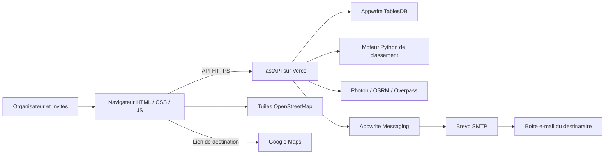

# meet’cool — dossier technique pour le cours

[Retour au projet](../README.md) · [English overview](../README.en.md)

## 1. Problème et parcours

Plusieurs personnes souhaitent se retrouver, mais leurs points de départ sont différents. meet’cool rassemble leurs départs et compare plusieurs points de rencontre selon un objectif explicite.

Le parcours comporte trois étapes :

1. **Créer** : l’organisateur choisit un nom, une date et éventuellement une adresse e-mail pour conserver son accès.
2. **Inviter** : il partage le lien public par WhatsApp, e-mail ou copie. Chaque invité accepte, puis indique la ville/adresse où il sera à cette date, ou autorise ponctuellement sa position actuelle. Aucun compte n’est nécessaire.
3. **Se retrouver** : l’organisateur compare les propositions, peut ajouter un point sur la carte, puis confirme un lieu. Les liens de destination ouvrent Google Maps.

Le site conserve deux liens différents : l’invitation publique et l’accès privé de l’organisateur. Le second permet de consulter les départs et de confirmer le lieu ; il ne doit pas être partagé avec les invités. Il est conservé dans le navigateur de l’organisateur et peut être envoyé par e-mail à sa demande.

## 2. Technologies réellement utilisées

| Élément | Technologie | Rôle |
| --- | --- | --- |
| Interface | HTML, CSS, JavaScript natif | Accueil animé et parcours en trois étapes, sans compilation frontend |
| Animations | CSS et JavaScript dans `static/motion.js` | Introduction, défilement, panneaux superposés et transitions ; respect de la préférence de mouvement réduit |
| Carte intégrée | Leaflet 1.9.4 + tuiles OpenStreetMap | Affichage de la carte, des départs et des propositions |
| Recherche d’adresses | Photon | Géocodage de villes et d’adresses à partir de données OpenStreetMap |
| Durées et tracés voiture | API OSRM | Matrice origine–destination et itinéraires routiers, sans trafic en direct |
| Lieux et feux proches | API Overpass | Présence cartographique de cafés, bibliothèques, restaurants, espaces collectifs et feux |
| Backend | Python, FastAPI, Pydantic | API HTTP, validation, permissions, calcul et orchestration |
| Appels externes | HTTPX | Requêtes HTTP vers les services de stockage, de carte et de messagerie |
| Stockage partagé retenu | Appwrite TablesDB via REST côté serveur | Conservation des rencontres et des participants entre appareils |
| E-mails | Appwrite Messaging + fournisseur SMTP Brevo | Reçus et confirmation du lieu |
| Stockage local | SQLite | Exécution autonome en développement sans Appwrite |
| Alternative préparée | Supabase | Adaptateur et schéma SQL disponibles, non nécessaires au déploiement Appwrite |
| Hébergement | Vercel, runtime FastAPI | Publication HTTPS et exécution du serveur à la demande |
| Vérification | pytest, tests HTTP simulés, Playwright | Algorithmes, API, confidentialité et parcours navigateur |
| Versionnement | Git / GitHub | Sources, documentation et historique des modifications |

La carte embarquée reste OpenStreetMap. Les boutons Google Maps sont de simples liens vers la destination et l’itinéraire : l’application n’utilise pas une API Google Maps payante.

## 3. Architecture et circulation des données



Le navigateur n’accède pas directement aux tables Appwrite. Les clés serveur restent dans les variables d’environnement du backend. Le navigateur demande une opération à FastAPI, qui contrôle les données et l’autorisation avant de contacter le stockage.

| Fichier | Responsabilité |
| --- | --- |
| `server.py` | Routes API, rencontres, contrôle du lien privé, génération des points et notifications |
| `engine.py` | Haversine, estimations, comparaison des lieux, Dijkstra et Floyd–Warshall |
| `geo.py` | Géocodage, matrice OSRM, tracés, proximité et caches |
| `storage.py` | Adaptateurs Appwrite, Supabase et SQLite |
| `notifications.py` | E-mails Appwrite, états d’envoi et liens Google Maps |
| `static/index.html` | Structure des pages, formulaires et explications pédagogiques |
| `static/app.js` | Navigation, invitations, carte et appels API |
| `static/motion.js`, `static/landing.css`, `static/styles.css` | Animations et présentation |
| `scripts/setup_appwrite.py` | Préparation des tables privées dans un projet Appwrite autorisé |
| `tests/` | Tests automatisés du backend |

## 4. Quel algorithme choisit réellement le lieu ?

### A. Générer un ensemble fini de candidats

Sans lieu ajouté manuellement, `meeting_candidates` dans `server.py` calcule le **centre sphérique** des départs. Les latitudes et longitudes sont converties en vecteurs sur une sphère, additionnées, puis reconverties en coordonnées. Cela gère mieux le passage de longitude +180° à −180° qu’une simple moyenne des longitudes.

Le serveur propose ensuite **quatre points indicatifs** : le centre, un point au nord, un à l’est et un au sud. Les décalages actuels sont de 0,008 degré. Ce sont des coordonnées de recherche, **pas des établissements vérifiés**. Un point peut être inaccessible ; l’utilisateur doit vérifier ou ajouter un endroit réel sur la carte. Cette génération est une heuristique et ne garantit pas de trouver le meilleur endroit de toute une ville.

### B. Construire une matrice de durées

Pour P personnes et L lieux, la matrice `T[i][j]` contient la durée du départ i au lieu j.

La matrice routière OSRM est demandée uniquement si :

- toutes les personnes ont choisi la voiture ;
- le groupe contient de 1 à 12 personnes ;
- il y a de 1 à 20 lieux ;
- le service fournit une matrice complète et valide.

Sinon, le calcul utilise une estimation :

```text
minutes = 60 × distance_Haversine_km × coefficient_de_détour / vitesse_km_h
```

| Mode | Vitesse de l’estimation | Coefficient de détour |
| --- | ---: | ---: |
| Voiture | 48 km/h | 1,32 |
| Vélo | 16 km/h | 1,22 |
| Marche | 4,5 km/h | 1,18 |
| Transports | 25 km/h | 1,50 |

Ces valeurs sont des hypothèses simples, pas un calcul d’horaires de bus/train. Le repli est signalé dans l’interface. La limite de 12 concerne la matrice OSRM, **pas le nombre de personnes qu’on peut inviter**. Les invitations n’ont pas de plafond fixe dans l’interface, mais les services et ressources ont évidemment des limites pratiques.

### C. Comparer exhaustivement les candidats

La fonction `optimize` parcourt **tous les lieux fournis**, calcule leurs scores, puis les trie. Le premier est donc optimal **dans cet ensemble fini et pour cette matrice**, pas parmi tous les lieux du monde.

Pour un lieu j, avec `a[i]` la disponibilité de départ de la personne i :

| Choix utilisateur | Score à minimiser | Départage des égalités |
| --- | --- | --- |
| Plus tôt | `max(a[i] + T[i][j])` | Temps total, puis écart |
| Équitable | `max(T[i][j]) − min(T[i][j])` | Temps total, puis dernière arrivée |
| Moins de trajet | `sum(T[i][j])` | Trajet le plus long |

Le moteur contient aussi un objectif `minimax` accessible par API : minimiser le trajet maximal, puis le total. Dans l’interface, si tous les départs sont disponibles au même moment, « Plus tôt » revient à minimiser le trajet maximal.

**Point important sur la date :** le moteur utilise la date de rencontre comme référence minimale de départ. Il ne calcule actuellement pas une heure de départ permettant d’arriver avant une échéance fixe. Des fenêtres de disponibilité peuvent être fournies au moteur ; les lieux faisables sont classés avant les autres. L’interface simplifiée n’expose pas toutes ces options.

Complexité du classement après obtention des durées : **O(P × L)** pour les scores, puis **O(L log L)** pour le tri. La matrice occupe O(P × L) en mémoire. Le temps réseau d’OSRM est séparé de ce coût de calcul local.

### Exemple vérifiable

Deux personnes peuvent partir au même moment :

| Lieu | Camille | Alex | Maximum | Écart | Total |
| --- | ---: | ---: | ---: | ---: | ---: |
| A | 10 min | 30 min | 30 min | 20 min | 40 min |
| B | 22 min | 22 min | 22 min | 0 min | 44 min |

- **Plus tôt choisit B** : le groupe est réuni en 22 minutes au lieu de 30.
- **Équitable choisit B** : personne ne voyage plus longtemps que l’autre.
- **Moins de trajet choisit A** : 40 minutes cumulées contre 44.

Les trois objectifs répondent à des questions différentes ; il n’existe pas un unique « meilleur » lieu sans définir le critère.

## 5. Où interviennent Dijkstra et Floyd–Warshall ?

Ces algorithmes sont implémentés et testés dans `engine.py`. La route `/api/algorithms/demo` les exécute sur un petit graphe pédagogique. La rubrique « Comment ça marche ? » affiche leurs résultats.

**Ils ne sont pas appelés localement pour choisir le lieu réel.** Les temps routiers réels sont demandés à OSRM ; meet’cool ne prétend pas connaître l’algorithme interne de ce service. Ensuite, meet’cool applique son propre classement exhaustif.

### Dijkstra

Il calcule les plus courts chemins depuis un sommet dans un graphe à poids non négatifs. La version du projet utilise un dictionnaire d’adjacence, une file de priorité (`heapq`), un tableau de distances et des prédécesseurs pour reconstruire le chemin. Les poids négatifs sont refusés. Complexité habituelle : O((V + E) log V).

Graphe de démonstration : A→B=4, A→C=12, B→C=3, B→D=9, C→D=2. Depuis A, le meilleur chemin vers D est **A→B→C→D**, de coût **9**.

### Floyd–Warshall

Il calcule les plus courtes distances entre toutes les paires de sommets. Il initialise une matrice puis essaie chaque sommet k comme intermédiaire :

```text
d[i][j] = min(d[i][j], d[i][k] + d[k][j])
```

Les trois boucles donnent **O(V³)** en temps et O(V²) en mémoire. La démonstration travaille sur le même petit graphe ; une distance infinie signifie qu’aucun chemin n’est disponible.

Aucun document de cours n’est inclus dans ce dépôt. L’adéquation exacte aux consignes et au programme doit être vérifiée avec le professeur ; cette documentation décrit le code présent, sans inventer une obligation pédagogique.

## 6. Persistance, invitations et e-mails

Appwrite stocke deux tables privées : `meetings` et `participants`. Le serveur traite les listes par pagination. Les données métier sont sérialisées dans un champ `payload` ; les participants possèdent aussi un identifiant de rencontre indexé.

Les e-mails sont optionnels : reçu du créateur avec son lien privé, reçu d’inscription pour l’invité et confirmation du lieu avec les liens Google Maps. L’enregistrement a lieu avant la tentative d’envoi : une panne e-mail ne supprime pas une rencontre. Un identifiant déterministe de notification aide à éviter un double envoi lors d’une relance technique. Un état « envoyé » du service ne prouve pas la lecture ni l’arrivée en boîte principale.

Le projet déployé utilise Appwrite Messaging relié à Brevo comme fournisseur SMTP. Aucun mot de passe SMTP n’a à être placé dans le code. Le bouton « E-mail » de partage ouvre, lui, le client de messagerie de l’utilisateur : il prépare un message et **ne l’envoie pas automatiquement**.

## 7. Publication et reproduction

### Développement local

L’interface a été construite en HTML/CSS/JavaScript natif, puis reliée à l’API Python. Les modules du calcul, du stockage, de la géographie et des notifications sont séparés. Les versions du parcours ont été vérifiées avec des tests automatisés et des essais navigateur sur ordinateur et mobile. Il n’y a pas de build Node nécessaire pour exécuter le site.

Le projet cible Python 3.12 (version déclarée dans `pyproject.toml`) ; les vérifications locales de cette livraison ont aussi été exécutées avec Python 3.13. Depuis un clone du dépôt :

```sh
python3.12 -m venv .venv
source .venv/bin/activate
pip install -r requirements.txt
uvicorn server:app --reload
```

Ouvrir `http://127.0.0.1:8000` ; la documentation interactive de l’API est à `/docs`. Sans configuration partagée, SQLite est créé localement. Il ne doit pas être ajouté à Git.

### Préparer Appwrite

Copier les **noms** des variables de `.env.example` et fournir les vraies valeurs dans l’environnement serveur : `APPWRITE_ENDPOINT`, `APPWRITE_PROJECT_ID`, `APPWRITE_API_KEY`, `APPWRITE_DATABASE_ID`. Les clés ne sont pas dans le dépôt. Les variables Supabase sont une alternative : il ne faut pas recopier leurs valeurs d’exemple comme une configuration réelle.

Dans un projet Appwrite prévu pour l’application, exécuter `python scripts/setup_appwrite.py` avec les droits de préparation requis. Le script crée la base et les tables dédiées si elles n’existent pas. En exploitation, conserver une clé serveur avec les droits nécessaires à la lecture/écriture des données ; les e-mails nécessitent aussi `providers.read`, `messages.write` et `messages.read`. Configurer un fournisseur e-mail actif dans Appwrite Messaging et vérifier l’expéditeur chez ce fournisseur.

### Héberger sur Vercel

Le projet a été lié à Vercel puis déployé avec sa CLI. `vercel.json` sélectionne le runtime FastAPI. Les variables Appwrite sont configurées dans Vercel côté serveur pour les environnements voulus (**Preview** et/ou **Production**). Le fichier local `.env.appwrite` n’est jamais déployé.

```sh
vercel link
vercel deploy                  # aperçu
vercel inspect <url-apercu> --wait
vercel deploy --prod           # publication principale volontaire
```

Vercel sert le site en HTTPS, ce qui permet la géolocalisation avec l’autorisation du navigateur. Son système de fichiers n’est pas une base persistante : sans Appwrite ou Supabase configuré, l’application désactive la création de rencontres sur Vercel. `PUBLIC_APP_URL` doit être fixé au domaine public retenu pour que les e-mails pointent vers le bon site.

L’adresse publique principale est [meetcool-three.vercel.app](https://meetcool-three.vercel.app/). Un aperçu Vercel est une version distincte ; son existence ne signifie pas que la version principale a été remplacée. Un déploiement CLI et un dépôt GitHub ne constituent pas à eux seuls une intégration continue : les déploiements automatiques à chaque push nécessitent de connecter le dépôt à Vercel.

## 8. Confidentialité et limites

- La géolocalisation est déclenchée après un choix explicite, sans suivi continu.
- Les invités ne reçoivent pas les adresses e-mail ni les coordonnées des autres invités via l’API publique.
- L’accès organisateur est un **lien porteur d’un secret** : toute personne qui le possède peut administrer la rencontre. Il ne remplace pas un compte utilisateur avec révocation et récupération de mot de passe.
- Les tables Appwrite sont réservées au serveur. Les secrets, bases locales et fichiers d’environnement sont exclus de Git et du déploiement.
- La présence de feux vient d’OpenStreetMap : leur couleur et leur durée en direct sont inconnues.
- OSRM ne fournit pas le trafic en direct ; les autres modes sont estimés, sans horaires de transports.
- Les services publics gratuits peuvent ralentir ou être indisponibles. La couverture mondiale dépend de leurs données et de leur disponibilité.
- Les gros groupes et les écarts géographiques extrêmes rendent l’heuristique des quatre points moins pertinente. Il faut alors fournir des lieux adaptés.
- Le prototype ne propose pas encore de comptes, de limitation complète des abus, de suppression programmée des données ou de suivi de livraison exhaustif. Ces points seraient nécessaires pour un service public exploité à grande échelle.

## 9. Tests et présentation en classe

```sh
python -m pytest -q
node --check static/app.js
node --check static/motion.js
python -m compileall -q server.py geo.py storage.py engine.py notifications.py
```

Le dossier `tests/` vérifie notamment Dijkstra/Floyd, les scores, le stockage, les permissions organisateur, la confidentialité, les services géographiques simulés et les états d’e-mail. Le scénario `scripts/check_planner.mjs` vérifie le parcours navigateur avec des appels simulés : il ne crée pas de vraie rencontre et n’envoie pas d’e-mail. Il nécessite Playwright dans un environnement d’outils séparé, ou une installation locale compatible.

Pour l’oral : montrer la création, ouvrir l’invitation dans un autre navigateur, renseigner un départ prévu, calculer le lieu, changer l’objectif, puis expliquer l’exemple A/B. Ouvrir ensuite les démonstrations de graphes pour distinguer **recherche d’un chemin** et **choix d’un lieu parmi des candidats**.

## 10. Méthode et transparence

Le projet a été développé avec l’assistance d’un agent de programmation (Codex) pour l’implémentation, les corrections, les tests et la documentation. L’élève doit relire le code, vérifier sa conformité au cours et être capable d’expliquer le parcours, les formules, les hypothèses et les limites. Les règles de déclaration de l’établissement restent à vérifier.

Références officielles utiles : [FastAPI](https://fastapi.tiangolo.com/), [Pydantic](https://docs.pydantic.dev/), [Leaflet](https://leafletjs.com/), [OpenStreetMap](https://www.openstreetmap.org/copyright), [Photon](https://github.com/komoot/photon), [OSRM](https://project-osrm.org/docs/v5.24.0/api/), [Overpass](https://wiki.openstreetmap.org/wiki/Overpass_API), [Appwrite](https://appwrite.io/docs), [Brevo](https://developers.brevo.com/), [FastAPI sur Vercel](https://vercel.com/docs/frameworks/backend/fastapi).

## 11. Version bilingue et dépôt GitHub

Le code et ce dossier sont versionnés dans [Altay55stage/meetcool](https://github.com/Altay55stage/meetcool). Le dépôt est initialement privé : l’accès du professeur nécessite une invitation GitHub ou un changement volontaire de visibilité. Aucun fichier de clé, donnée de rencontre locale ou configuration de compte n’est inclus. La première publication Git correspond à un instantané du projet existant ; elle ne reconstitue pas artificiellement l’historique de développement précédent.

Le sélecteur FR/EN traduit l’accueil, le parcours organisateur, les formulaires invités et les explications pédagogiques. `static/translations.js` contient le dictionnaire anglais et `static/i18n.js` applique les textes/attributs et conserve la préférence dans le stockage local du navigateur. Les valeurs des formulaires restent intactes lors du changement de langue. Les liens publics portent `lang=fr` ou `lang=en` pour ouvrir l’invitation dans la langue choisie. Aucun service de traduction externe ne reçoit les données. Les e-mails transactionnels restent en français dans cette version.

[La version bilingue en aperçu](https://meetcool-hk5r71d6v-ac-07b0.vercel.app/) est distincte du domaine de production. Les vérifications de cette livraison comprennent 80 tests pytest, les contrôles de syntaxe JavaScript/Python, un contrôle de secrets sur les fichiers publiés et le parcours Playwright en français et anglais, avec API de rencontres simulée.
